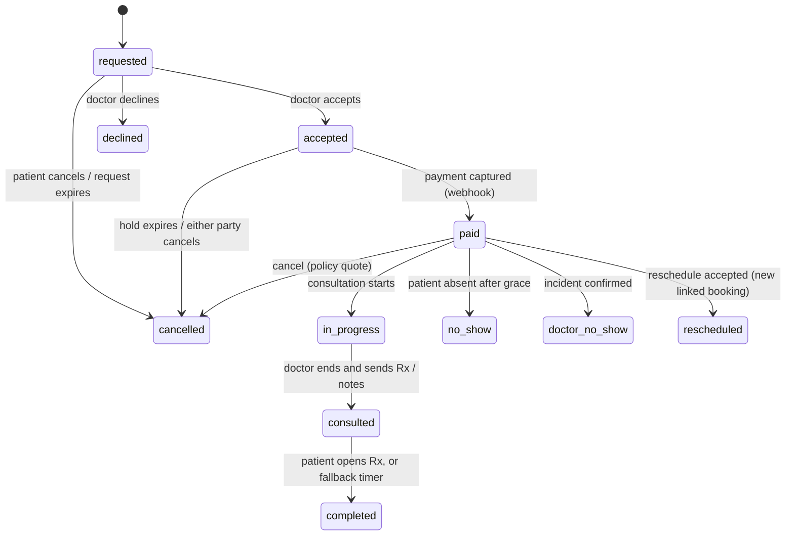

# CHARAK next release: implementation plan

- **Status:** Draft for founder review, 26 Oct 2026
- **Input:** *CHARAK Product Requirements and Implementation Specification v1.0* (26 Oct 2026). This plan
  treats the spec as direction, not a literal checklist. Where the plan departs from the spec, §3.15 says
  why.
- **Related:** `docs/legal/DECISIONS.md` (LD-003 no fee, LD-004 role in payments, LD-005 refunds,
  LD-006 payouts), `design-system/README.md`.

---

## 0. Summary

The spec covers nine product areas: consent, cancellation and refunds, the home-visit journey, a pricing
matrix, prescriptions, completion when the patient views the prescription, follow-ups, reviews and
reliability, and earnings and payouts. It also covers the admin tools behind them. About a third of this
exists in some form today. The money paths exist but aren't safe enough to build more money features on.

**Approach.** First build a small transactional core: a booking state machine with an event log,
idempotency keys, a double-entry ledger, a job queue and a notification outbox. Then ship the features in
vertical slices. Each slice includes its patient, doctor and admin screens.

**Doctor money (LD-006, decided).** Fees build up in the doctor's earnings balance. Each fee becomes
withdrawable 48 hours after its consultation is complete, and the doctor withdraws whenever they choose.
The recommended rail is **Razorpay Route with UPI (VPA) settlement**: the money waits in Razorpay's escrow
as a held transfer, and "Withdraw" releases it to the doctor's UPI ID. Every business number (refund %,
grace periods, hold time) is versioned data, not code, so open decisions don't block the build.

**Fix now (live today, separate from the new features):**

1. **A refund is marked `refunded` before Razorpay confirms it, and a failed refund is only logged**
   (`backend/app/routers/payments.py` `_razorpay_refund`). The patient may never get the money, and nothing
   shows it.
2. **Cancelling after a payout run leaves things half done.** `cancel_booking` sets the booking to
   `cancelled`, marks the payment refunded and calls Razorpay. Then `payouts.reverse()` raises a 409
   because the ledger entry is already `paid`. The patient sees an error but is refunded, and the doctor
   keeps the payout. Charak pays twice.
3. **The doctor's Earnings tab doesn't read the ledger.** `/earnings/me` adds up `price_confirmed` on
   completed bookings. On a closer look this is cosmetic today: refunds only happen on bookings that
   aren't complete, and the tab already leaves those out. Only ops adjustments are missing. It moves to
   Phase 5 and is no longer a hotfix.
4. **Ledger credits are made when the payment is captured, before the visit happens.** A payout run
   sweeps anything `payable` by date, which can include visits that haven't happened yet.
5. **Check what calls `/maintenance/*` in production.** The runbook describes Fly, but production runs on
   Cloud Run. If no scheduler is set up, payment holds never expire and OTP and rate-limit rows never purge.
6. Stale copy: the doctor app shows "Visit completed — patient can now pay"
   (`active_visit_screen.dart:126`), but completion now requires payment first.

---

## 1. Where the code is today

| Area | Today | Gap against the spec |
|---|---|---|
| Data access | FastAPI talks to Postgres through supabase-py (PostgREST over HTTP) with the service-role key. RLS is on and client grants are revoked (0021). Races are handled by compare-and-set updates and unique indexes. | PostgREST can't run one transaction across several calls. Cancel → refund → ledger can half-apply (see "Fix now" #2). |
| Booking lifecycle | `requested → accepted` (10-min payment hold) `→ paid → completed`. Also `declined`, `cancelled` (with `cancelled_by`) and `no_show` (patient). Each router checks status strings itself. | No event history. No journey, in-progress or prescription stages. No doctor no-show and no reschedule. Transitions aren't defined in one place. Unanswered requests never expire. |
| Cancellation | Either party can cancel any non-terminal booking. A paid booking is always refunded in full, and the app promises that. | Not driven by a policy. Doesn't match LD-005. No deadline is shown. |
| Refunds | Fire-and-forget. Refund webhooks are ignored. No partial refunds and no refund record. | See "Fix now" #1. Spec §6.4. |
| Payments | One Razorpay order per booking. A signed `payment.captured` webhook confirms it, and late captures are refunded automatically. Amounts are `numeric(10,2)` rupees. | A good base. It still needs deduplication by event id, reconciliation and paise. |
| Ledger and payouts | `doctor_ledger_entries` has a mutable status (`payable`, `paid`, `reversed`). Ops sweeps entries into `payouts` by date and marks them paid by hand. | Not append-only. No hold period, no withdrawal by the doctor and no payment-provider integration. |
| Pricing | One `doctor_pricing` row per doctor and channel: fee, base length and extra-time rate. The fee is snapshotted to `bookings.price_confirmed`. | No duration options, no first vs follow-up price and no history. |
| Slots | A unique index on `(doctor_id, scheduled_start)` among live bookings (0010). | Variable durations need protection against overlapping times, not just equal start times. |
| Consent | `consents` table (tos, privacy, telemedicine, marketing + version + ip). The apps show a passive "By continuing you agree" footer and record consent best-effort. Versions are hard-coded in two places. | Needs unticked checkboxes, server-side enforcement, document hashes, a booking-policy snapshot and doctor terms. |
| Prescriptions and follow-ups | None. | The whole feature. |
| Journey | The doctor app has "Navigate to patient" and "Running late" (a notification only). | No journey event. |
| Ratings | One star rating and comment per completed booking. A trigger recomputes `doctors.rating_avg` on insert. | No dimensions, review count, review window, moderation or reliability measure. |
| Complaints | A free-text complaint per booking. Ops sets its status. | No incident types, evidence, outcome, appeals, remedies or case IDs. |
| Notifications | A `notifications` table plus FCM v1, sent inline or as a background task. The outcome is recorded. Each user has one FCM token column. | No deduplication, retries, scheduling or preferences. Only one device per user. |
| Audit | `audit_log` records actor, entity, action and IP. Ops only, best-effort. | No reason, before/after values or metadata. Append-only isn't enforced. System, patient and doctor actions aren't recorded. |
| Admin | Overview, Verification, Bookings, Complaints, Directory, Senior review and Deletion pages. One ops role. | No timeline, refunds, payouts, incidents, reviews or policy-audit pages. No role-based access. |
| Calls | Agora video. The backend mints every join token. | Joins aren't logged, so there's no evidence when someone doesn't show. |

---

## 2. What large platforms do, and what we take

| Problem | What large platforms do | What CHARAK takes |
|---|---|---|
| Two writers racing on one booking (cancel vs Start Journey, double taps) | Stripe PaymentIntents and Uber trips use one server-owned state machine. Each transition runs under a lock and is recorded as an immutable event. | A `transition_booking()` Postgres function. It locks the row (`SELECT … FOR UPDATE`), checks the actor and the current state, and writes `booking_events` in the same transaction. |
| Retries creating duplicates | Stripe's `Idempotency-Key` header. RazorpayX's `X-Payout-Idempotency`. | An `Idempotency-Key` on every write the apps make. The stored response is replayed for 24 hours. Calls to Razorpay carry CHARAK's own keys. |
| Keeping money correct | Stripe, Square and Modern Treasury use double-entry ledgers: entries are immutable, pending and posted balances are separate, and balances are derived from entries. | Ledger accounts and immutable entries. Each transaction's debits equal its credits. No mutable status on money rows. |
| Calls to the payment provider and its webhooks | Store the event, acknowledge quickly, process it idempotently, and reconcile against the provider's API. | A webhook inbox, unique on the provider's event id. Refund and transfer "intent" rows are driven by a worker. A reconciler runs hourly and nightly. |
| Marketplace payouts in India | Razorpay Route splits the payment, holds it and releases it later. The funds stay in the payment aggregator's escrow account (RBI PA rules). | A Route transfer on capture with `on_hold=true`. It's released when the earning becomes available, automatically or when the doctor taps Withdraw. |
| Cancellation fees | Urban Company: free until close to the slot, then a fee that goes to the professional. Uber: a fee once the driver has been travelling. Airbnb: a versioned policy shown at checkout. | Versioned cancellation policies stored as data. The quote and the cancellation use the same function. Any fee goes to the doctor through the ledger. |
| Late arrivals and no-shows | Uber shows "Driver not coming?" help after the ETA. Practo lets a patient change doctor when the doctor doesn't respond. | A "Doctor hasn't arrived?" / "Doctor hasn't joined?" action after the grace period. It offers a refund or a replacement on the spot. |
| Proof for online no-shows | Video platforms log joins. | Log each party's call join (CHARAK mints every Agora token). Agora's channel-event webhooks can be added later. |
| Ratings | Uber averages the last 500 ratings and drops ratings for things outside the driver's control. Zocdoc takes reviews only from verified patients, shows overall + bedside manner + wait time, and providers can't pay to remove reviews. Airbnb has a review window and sub-ratings. | Reviews only from verified bookings, within 14 days. An overall rating plus 3 optional sub-ratings, averaged over a rolling window. "New" below 5 reviews. Reliability is kept separate. |
| Discipline | Uber and DoorDash give notice and allow appeals before deactivating someone. Airbnb discloses host-cancellation penalties up front. | An incident is reviewed, then confirmed, dismissed or marked undetermined, and can be appealed. Only confirmed incidents count. |
| Prescriptions | Practo and Eka Care store a structured prescription and render a signed PDF in the Telemedicine Practice Guidelines (TPG) format. | The structured prescription is the source of truth. The server renders the PDF with the registration number and signature. Versions are immutable. Doctors can also upload a handwritten prescription. |
| Health data in notifications | Standard practice for health apps: no medical detail on the lock screen. | Generic text plus a deep link. The content is shown only inside the signed-in app. |
| Background jobs | pg-boss, Graphile Worker and Rails Solid Queue use Postgres as the queue (`FOR UPDATE SKIP LOCKED`). | A `jobs` table with a claim function, run by a Cloud Scheduler tick every minute. |
| Staff access to medical data | Hospital record systems use "break-glass" access: allowed with a reason, logged and reviewed. | Admins don't see prescription content by default. "View with reason" writes an audit event, like the existing phone-reveal pattern. |

---

## 3. Architecture decisions

### 3.1 Booking and money changes run inside Postgres functions

- **Decision.** Every change that touches booking state or money runs as one `plpgsql` function called
  with `supabase.rpc()`. Each function locks the rows it needs, checks the actor and the current state,
  and writes the state change, the event, the ledger entries, the outbox rows and the jobs in one
  transaction.
- **Rules.**
  - Functions are `security definer` with `set search_path = public`, and only `service_role` may
    execute them.
  - Each function takes `p_actor_id`, `p_actor_role`, `p_idempotency_key` and `p_now` (the clock is
    injectable, so tests are deterministic).
  - A function never calls Razorpay. It records an intent, and a worker makes the call (§3.6).
- **Why.** PostgREST can't open a transaction across calls. Compare-and-set updates got the booking row
  right, but the multi-row paths still half-apply ("Fix now" #2).
- **Alternative considered.** A direct psycopg connection through Supavisor. The logic would stay in
  Python, but it adds a second data path and connection pooling on Cloud Run, and still needs the same
  locking. Revisit if there are more than about 25 functions.
- **Testing.** The integration suite (`backend/tests/integration`, real Postgres) is the gate for these
  functions. The MagicMock unit tests can't see SQL.

### 3.2 Booking state machine and `booking_events`

- **Status values.** Existing values on the wire stay the same (`paid`, `no_show`).
  - `requested` → `accepted` (awaiting payment) → `paid` (shown as **Confirmed**) → `in_progress` →
    `consulted` (prescription or notes sent, waiting for the patient to view them) → `completed`.
  - Terminal states: `declined`, `cancelled` (with `cancelled_by` and `cancel_reason_code`), `no_show`
    (patient), `doctor_no_show`, `rescheduled` (replaced by a linked booking).
- **Separate state machines, not booking statuses.** Journey, payment, refund, incident ("disputed") and
  reschedule requests. The spec's `refund_pending`, `refunded` and `disputed` live on those, so a booking
  doesn't need twelve statuses.
- **Allowed transitions** are rows in a `booking_transitions` table (from, to, allowed roles). The
  function reads that table, so the rules exist in one place.
- **`booking_events`** is insert-only (a trigger rejects UPDATE and DELETE). Each row has the event type,
  the from and to statuses, the actor and role, `occurred_at` (server time), safe metadata and the
  idempotency key (unique).
- **New in the flow.** Requests the doctor doesn't answer expire automatically (a job cancels them as
  `system`, and the patient is told). Today a request can sit until its slot passes.

### 3.3 Idempotency

- The apps send an `Idempotency-Key` (a UUID made once per user action and reused on retry) on: create
  booking, create order, cancel, start journey, start or end the consultation, submit a prescription,
  submit a review, report an issue, withdraw and reschedule.
- An `idempotency_keys` table stores user, route, request hash, response status and body, and creation
  time, for 24 hours. The same key with a different body returns 422.
- This is implemented as a FastAPI dependency. Keys are also passed into the SQL functions, so the
  database deduplicates too.

### 3.4 Double-entry ledger

It replaces the mutable `doctor_ledger_entries`.

- **Platform accounts:**
  - `razorpay_clearing`: money held at Razorpay.
  - `patient_refunds_payable`.
  - `platform_fees`: 0 at launch, per LD-003.
  - `gateway_fees`: see decision N2.
- **Accounts for each doctor:** `pending`, `available`, `in_transit`.
- **Tables.** `ledger_transactions` has one or more `ledger_entries`, and the entries must sum to zero.
  A constraint makes `(source_type, source_id, kind)` unique, which makes posting idempotent. Entries are
  insert-only. Balances are derived; a cached balance row is updated in the same transaction and locked
  when a payout is reserved.

| Event | Posting |
|---|---|
| Payment captured, ₹1,000 | clearing → doctor `pending` ₹1,000 |
| Refund decided before release, ₹800 | doctor `pending` → `patient_refunds_payable` ₹800. On `refund.processed`: refunds payable → clearing |
| Late-cancellation fee kept | The fee stays in doctor `pending` and is released like any other earning |
| Earning released at `rx_sent_at + 48h` if `rx_viewed_at <= rx_sent_at + 48h`, otherwise at `rx_sent_at + 72h` (LD-006). A kept cancellation amount is released 48 h after `cancelled_at`. Skipped while an incident, refund or complaint is open | doctor `pending` → doctor `available` |
| Withdraw | doctor `available` → doctor `in_transit` (reserves the amount). On settlement: `in_transit` → clearing. On failure: back to `available` |
| Refund after release (complaint upheld) | doctor `available` → refunds payable. This can go negative. It's recovered from future earnings and shows in an admin queue |

- **Migration.** Backfill the existing entries (`payable` becomes `pending` or `available`; `paid`
  becomes paid out) and reconcile them to the paisa against the old table. The old table stays read-only
  and is dropped later.

### 3.5 Money rail: Razorpay Route with UPI settlement (recommended, decision N1)

The product rule is decided (LD-006):

- Fees build up in the doctor's earnings balance.
- Each fee becomes withdrawable **between 48 and 72 hours after the prescription is sent**. The default is
  72 hours. It drops to 48 hours if the patient opens the prescription within the first 48 hours. The
  doctor app says: "Ready to withdraw 48–72 hours after you send the prescription."
- The doctor taps **Withdraw** whenever they choose.
- Money tied to an open refund, complaint or incident stays on hold.

Both rails below can pay a doctor's **UPI ID**.

**Route, recommended**

- **On capture.** The webhook handler creates a transfer of the doctor's share to the doctor's **linked
  account** with `on_hold=true` and no `on_hold_until`. Route allows indefinite holds.
- **Withdraw.** The backend sets `on_hold=false` on every transfer that is withdrawable. Razorpay pays it
  out by IMPS to the doctor's UPI ID or bank account. Transfer and settlement webhooks close the ledger
  (`in_transit` → paid out).
  - Each transfer belongs to one consultation, so Withdraw takes **everything withdrawable** at once.
    Partial amounts aren't possible.
- **UPI (VPA) settlement.**
  - Razorpay support must enable it, and it works in live mode only.
  - Razorpay checks the UPI ID in about 3 seconds and returns the account holder's name. CHARAK must
    compare that name with the doctor's verified name and store the result.
  - Caps: ₹1,00,000 per transfer and per UPI ID per day (an NPCI limit). Above that, the doctor needs a
    bank account on file.
- **Fees.** IMPS costs ₹2–5 + GST per settlement (Razorpay docs). Ask Razorpay whether releasing several
  transfers on the same day is settled as one IMPS or as one per transfer.
- **Refund before release.** The refund includes a transfer reversal, so the money comes back from the
  held transfer.
- **Replacement doctor.** Reverse the held transfer and create one for the new doctor. Razorpay must
  confirm how a transfer is re-created on an already captured payment (Phase 0).
- **Requirements.**
  - Route and VPA settlements must be activated on CHARAK's Razorpay account. Apply now, because it takes
    time.
  - Each doctor becomes a linked account (`business_type: individual`), using the UPI ID and/or bank
    details already collected in Profile → Payout details.
- **Why Route.** Patient money never lands in CHARAK's current account. That fits LD-004 (limited
  collection agent) and RBI's payment-aggregator rules better than paying doctors out of CHARAK's own
  account. Holds give the 48-hour window for free.

**Alternative: RazorpayX Payouts**

- Payouts go by UPI or IMPS from CHARAK's current account, with `X-Payout-Idempotency`.
- Any amount can be withdrawn, as one payout per withdrawal. The first 250 payouts each month are free,
  then ₹4–9 + GST each.
- But CHARAK would hold patient money from capture until withdrawal, which needs the CA and lawyer
  sign-off already flagged in LD-004.

The ledger doesn't depend on the rail, so this decision only changes the payout adapter.

### 3.6 Payment-provider integration (refunds, transfers, payouts)

1. A database function writes the intent row (for example `refunds.status = pending`), the ledger
   postings and a job, in one transaction.
2. A worker calls Razorpay with CHARAK's key. The refund id goes in `notes`, and the worker looks up the
   refund before creating it, so a retry never refunds twice.
3. The API response moves the refund to `processing`, `processed` or `failed` (through a function).
4. **Webhook inbox.** The handler verifies the signature and inserts the event into `webhook_events`,
   unique on `x-razorpay-event-id`. It returns 200 at once, and a job processes the event. Statuses only
   move forward, so events arriving out of order are safe. The handler also subscribes to `refund.*`,
   `transfer.*`, `settlement.*` and `payment.dispute.*`.
5. **Reconciler.** Every hour it checks items stuck for more than 30 minutes; every night it compares
   everything against the Razorpay API. It moves mismatched records forward and lists them in an admin
   queue.

The patient sees **Refund processing** until Razorpay sends `refund.processed`.

### 3.7 Jobs

- A `jobs` table: kind, payload, `run_at`, attempts, `max_attempts`, `locked_until`, `last_error` and a
  unique `dedupe_key`.
- `claim_jobs(n)` uses `FOR UPDATE SKIP LOCKED`.
- `POST /maintenance/tick` is called by Cloud Scheduler every minute (`X-Cron-Secret`, moving to OIDC). It
  runs due jobs within a time budget and backs off exponentially on failure. Jobs that keep failing go to
  a dead-letter queue shown in admin.
- **Jobs on this queue:**
  - payment-hold expiry (replaces today's sweep)
  - request expiry
  - reminders
  - refund calls
  - transfer releases
  - the completion fallback
  - flags for overdue prescriptions
  - review prompts
  - the reconciler
- Cloud Run only gives a request CPU while it runs, so each job must be short. Cloud Tasks per job would
  be more infrastructure than CHARAK needs at this scale.

### 3.8 Notifications

- **Outbox.** Notifications are queued in the same transaction as the change that caused them. Each
  `notifications` row gets a unique `dedupe_key` (event id + recipient + template) and a `deliver_after`
  time, so one logical event is never sent twice.
- **Delivery.**
  - A job sends through FCM and records each try in `notification_deliveries`.
  - Temporary failures are retried with backoff, up to 5 times.
  - An unregistered token is removed.
  - Copy that says "delivered" only appears after FCM accepts the message.
- **Devices.** A `device_tokens` table (one row per device) replaces the single `fcm_token` column, so a
  doctor with two phones gets both notifications.
- **Privacy.** The text is generic for anything medical ("Your prescription is ready in CHARAK"). The
  data payload carries only the route and the ids. The app checks that the user is signed in and owns the
  item before showing it.
- **Preferences.** `notification_prefs` covers reminders and marketing. Service messages are always sent.

### 3.9 Policies are versioned data

- A `policies` table: kind (`cancellation`, `no_show_grace`, `completion_fallback`, `settlement`,
  `review_window`, `followup_reminder`), version, `rules jsonb` (checked by a schema in code),
  `effective_from`, `approved_by` and a link to the published document.
- Each booking records the policy versions in force when it was booked. Functions apply the booking's
  versions, never the current ones.
- A rule that hasn't been approved stays behind a feature flag and keeps today's behaviour, as the spec's
  rule 12 asks.

The home-visit cancellation rule (LD-005, decided 2026-10-26):

```json
{"channel": "home_visit", "version": "2026-10-26",
 "rules": [
   {"when": {"journey_started": true},                        "refund_pct": 0},
   {"when": {"minutes_before_start_lt": 120},                 "refund_pct": 50},
   {"when": {},                                               "refund_pct": 100}],
 "kept_amount_to": "doctor_earnings",
 "doctor_cancels_or_no_show": {"refund_pct": 100},
 "journey_start_window_minutes": 120}
```

- Rules are checked in order and the first match wins.
- `journey_start_window_minutes` means Start Journey can only be tapped in the 2 hours before the slot.
  So a cancellation 2 or more hours ahead is always a full refund, and an early tap can't take away the
  patient's refund.
- The online rule (LD-005: full refund at least 15 minutes before, none after) is still Proposed. It
  ships behind a flag that defaults to today's full refund until it's confirmed.

- **Legal documents.**
  - `legal_documents` stores type, version, locale, URL, a SHA-256 hash of the published text, a
    `material` flag and the publish date.
  - `policy_acceptances` stores the user, the document, the method (sign-up checkbox, booking
    confirmation, re-consent), the booking id, IP, app version and time. It's insert-only.
  - Existing `consents` rows are backfilled.
  - The apps read the current versions from `GET /legal/current` instead of hard-coding them.

### 3.10 Durations and overlapping bookings

- Bookings get `duration_min` and `scheduled_end` as part of the snapshot.
- The unique index on `(doctor_id, scheduled_start)` is replaced with an exclusion constraint (needs
  `btree_gist`):
  `exclude using gist (doctor_id with =, tstzrange(scheduled_start, scheduled_end) with &&) where (status in live statuses)`.
- The availability service generates slots for the duration the patient picks. A travel buffer for home
  visits, set by the doctor, can follow later.

### 3.11 Prescriptions

- **Storage.** The structured prescription lives in `prescriptions` and `prescription_items`. A trigger
  makes it immutable once submitted. A correction is a new version: the old one becomes `superseded` and
  the patient is told.
- **PDF.** Rendered on the server with ReportLab (pure Python, so it fits the slim image) into the
  private bucket at `prescriptions/{booking}/{rx}/{version}.pdf`, with its SHA-256 stored. It's served
  through a 5-minute signed URL from an endpoint that checks access.
- **Contents (TPG sample format):**
  - doctor's name, qualification, registration number and council, and contact
  - patient's name, age and sex, and the date
  - complaints and provisional diagnosis (entered by the doctor)
  - medicine lines: name, strength, form, dose, route, frequency (the familiar 1-0-1 picker), duration
    and instructions
  - investigations, advice, follow-up and the doctor's signature (an image uploaded once)
- **Clinical content.** CHARAK never writes or suggests clinical instructions.
- **Online consultations.** The doctor confirms they prescribed within the TPG rules for this mode of
  consultation (List O, A or B).
- **Handwritten prescriptions.** The doctor can upload one instead (PDF, JPEG or PNG, up to 10 MB,
  content sniffed as in `uploads.py`).
- **"Viewed" means** the patient's own session fetched the prescription detail
  (`GET /prescriptions/{id}`). Reads by the doctor or an admin, and notification previews, don't count.
  Only the first view moves the booking to `completed`. Later views are recorded but change nothing.
- **Retention.** Prescriptions are clinical records under LD-009: kept 3 years and de-identified on
  account deletion. `services/erasure.py` must cover them.

### 3.12 Money in paise

New tables store `bigint` paise plus `currency = 'INR'`. Bookings get `price_paise` next to
`price_confirmed`, and the API returns both until both apps have moved over.

### 3.13 Admin roles and break-glass access

- `admin_users.role` can be `support`, `ops_lead`, `finance` or `admin`. The backend maps roles to
  permissions.
- Prescription content and the patient's phone are shown only through "view with reason". This
  generalises the existing `/admin/bookings/{id}/phone` reveal and writes an audit event.

### 3.14 Audit, version 2

- `audit_events` is insert-only, enforced by a trigger. Each row records actor, role, action, entity,
  entity id, reason, before and after values (with medical detail redacted), request id and IP.
- It covers ops, system, doctor and patient actions. `booking_events` is the stream for each booking;
  `audit_events` covers everything else. Every override requires a reason.

### 3.15 Where this plan departs from the spec

1. **RLS.** The spec assumes Supabase Auth with RLS. CHARAK's clients don't talk to Supabase, so RLS
   stays deny-all (0021). Authorization lives in the API and in the actor checks inside the SQL
   functions. Don't bring back `auth.uid()` policies.
2. **Settlement follows the prescription (founder decision, LD-006).** The money becomes withdrawable
   72 hours after the prescription is sent, or 48 hours after if the patient opened it within the first
   48 hours. A patient who never opens it can't hold the doctor's money for more than 72 hours.
3. **Refund and dispute are separate states, not booking statuses.** Existing status values on the wire
   stay the same.
4. **A payout request is a hold release under Route**, not a bank transfer CHARAK starts (if N1 is
   Route).
5. **The overall rating is entered by the patient, not calculated from the sub-ratings.** It's simpler to
   explain and can't silently drift.
6. **A consultation can end with "Consultation notes" instead of a prescription.** Not every consultation
   needs medicines (decision N3).

---

## 4. State machines



| Machine | States |
|---|---|
| Journey (home visits) | none → `started` (one per booking; server time; can't be backdated) |
| Payment | `initiated` → `captured` → `partially_refunded` / `refunded`; `failed`; `disputed` |
| Refund | `pending` → `processing` → `processed` \| `failed` (retried, then manual) |
| Earning (derived from the ledger) | `pending` → `available` → `in_transit` → `paid_out`; `on_hold` while an incident, refund or complaint is open; `reversed` |
| Prescription | `draft` → `submitted` → `viewed`; `submitted` → `superseded` |
| Incident | `reported` → `under_review` → `confirmed` \| `dismissed` \| `undetermined`; `confirmed` → `appealed` → `upheld` \| `reversed` |
| Review | `published` → `reported` → `hidden` \| `restored`; `edited` within its window |
| Reschedule request | `proposed` → `accepted` (new booking) \| `declined` (remedies offered) \| `expired` |

---

## 5. Schema changes

Every migration only adds things. Columns and tables are dropped in a later migration, once both apps on
the new version are past the minimum supported version.

| Migration | Contents |
|---|---|
| `0022_core_events_jobs` | `booking_events`, `audit_events`, `idempotency_keys`, `jobs`, `webhook_events`, `booking_transitions`, `transition_booking()`. New booking statuses and columns: `journey_started_at`, `started_at`, `consulted_at`, `completed_at`, `completion_source`, `cancel_reason_code`, `cancelled_at`, `request_expires_at`, `duration_min`, `scheduled_end`, `price_paise`, `timezone default 'Asia/Kolkata'`. `app_config` (minimum app versions, feature flags). |
| `0023_legal_and_policies` | `legal_documents`, `policy_acceptances` (backfilled from `consents`), `policies`, policy snapshot columns on `bookings`. |
| `0024_payments_refunds_ledger` | `payments.amount_paise`, wider payment statuses, `refunds`, `ledger_accounts`, `ledger_transactions`, `ledger_entries`, balance view and cache, backfill and reconciliation. |
| `0025_visit_and_prescriptions` | `prescriptions`, `prescription_items`, `care_episodes`, `follow_up_recommendations`, the doctor's signature path, `call_participants` (join and leave events). |
| `0026_pricing_matrix` | `doctor_price_rules` (doctor, channel, `duration_min`, `visit_category` initial/follow_up, `price_paise`, active, `effective_from`/`effective_until`), backfilled from `doctor_pricing`. The exclusion constraint. The doctor's follow-up validity days. |
| `0027_route_payouts` | `doctor_payout_accounts` (Razorpay linked account id, KYC status, masked bank details), `route_transfers`, `withdrawals`. |
| `0028_reviews_incidents` | `reviews` (overall, dimensions, comment, status, edit deadline; `ratings` rows backfilled), `review_reports`, `doctor_rating_aggregates`, `incidents`, `incident_evidence`, `incident_appeals`, `remedies`, `reschedule_requests`, `support_cases` (readable ids such as `CHK-7F3K2`). |
| `0029_notifications_v2` | `notifications.dedupe_key`/`deliver_after`/attempts, `notification_deliveries`, `device_tokens`, `notification_prefs`. |
| `0030_admin_rbac` | `admin_users.role` and a permission seed. |

**Indexes.** The spec's §18.3 list, plus partial indexes for every admin queue (for example incidents
where `status in ('reported','under_review')`, refunds where `status in ('pending','processing','failed')`,
jobs where `run_at <= now() and locked_until is null`).

---

## 6. API changes

**Patient**

- `GET /legal/current`, `POST /legal/accept` (several documents at once, idempotent)
- `GET /doctors/{id}/prices?channel=&follow_up_of=`: the options the patient can book, with durations
- `GET /bookings/{id}/cancellation-quote` returns `{deadline_at, refund_paise, fee_paise, policy_version, quote_token}`.
  The token expires after 2 minutes.
- `PATCH /bookings/{id}/cancel {quote_token, reason_code}`. If the outcome changed since the quote (for
  example the journey started), it returns 409 with a new quote, and the patient confirms again.
- `GET /bookings/{id}/timeline`
- `GET /prescriptions/{id}` (records the view), `GET /prescriptions/{id}/pdf` (a signed URL)
- `GET /follow-ups`, `POST /follow-ups/{id}/dismiss`
- `POST /bookings/{id}/review`, `PATCH /bookings/{id}/review` (within the edit window)
- `POST /bookings/{id}/report-issue {type: doctor_not_arrived | doctor_not_joined | call_failed | other}`
- `GET /bookings/{id}/remedies`, `POST /bookings/{id}/remedies/{refund|replacement}`
- `GET /me/payments`: payment and refund history

**Doctor**

- `POST /bookings/{id}/journey/start`, `/consultation/start`, `/consultation/end`
- `PUT /bookings/{id}/prescription` (save a draft), `POST /bookings/{id}/prescription/submit`,
  `POST /prescriptions/{id}/correct`
- `PUT /doctors/me/prices` (the matrix), `GET /doctors/me/prices/history`
- `GET /earnings/v2/summary`, `GET /earnings/v2/transactions`, `POST /earnings/withdraw`
- `POST /payouts/me/linked-account` (Route onboarding)
- `GET /doctors/me/ratings` (aggregates + reliability), `GET /doctors/me/incidents`,
  `POST /incidents/{id}/appeal`
- `POST /bookings/{id}/reschedule-request` (offers slots), `POST /bookings/{id}/report-issue`

**Admin**

- `GET /admin/bookings/{id}/timeline`, `GET /admin/queues/{name}`
- `POST /admin/incidents/{id}/decision`, `POST /admin/refunds/{id}/retry`
- `POST /admin/overrides` (reason required; shows before and after)
- `POST /admin/reviews/{id}/moderate`
- `GET /admin/pricing/{doctor_id}/history`, `GET /admin/legal/acceptances?user=`
- `GET /admin/reconciliation`, `GET /admin/jobs/dead`

**Webhooks:** the existing `/payments/webhook` gains refund, transfer, settlement and dispute events. An
optional `/calls/agora-webhook` can follow.

---

## 7. Client work

All screens follow the design system (`design-system/README.md`):

- tab roots use `CharakLargeTitleScaffold`
- pushed screens use `CharakTopBar` and `CharakCtaBar`
- every confirmation uses `showCharakConfirm`

New shared widgets go in `charak_core` and the gallery: a timeline, a money-breakdown row, a rating input,
a status pill with every state, a policy summary sheet and the consent checkbox.

**Patient app**

- **Sign-up.** Two unticked checkboxes (Terms, Privacy) and a separate optional marketing opt-in. A
  re-consent sheet appears when `/legal/current` says the user is out of date; it blocks for material
  changes.
- **Review and confirm, before payment.**
  - type, duration and price
  - "Free cancellation until 9:45 AM, Tue 4 Nov", with a policy sheet
  - the booking-policy checkbox
  - telemedicine consent on the first online booking
  - a "Not for emergencies. Call 112." notice (spec §20.13)
- **Booking detail.**
  - a timeline ("Doctor started travelling at 10:12")
  - cancel, with a live quote in the confirm sheet
  - "Doctor hasn't arrived?" or "Doctor hasn't joined?" after the grace period
  - reschedule offers, remedies and the support case ID
- **After the visit.**
  - Prescription viewer: the structured view first, then a PDF button.
  - Follow-up card: "Book follow-up" opens with the doctor and the follow-up price filled in.
  - Review: overall stars, 3 optional sub-ratings, optional "what went well" chips and a comment.
    Prompted once, never nagged.
- **Profile → Payments.** Every payment and refund, with its status.

**Doctor app**

- **Consent.** A practitioner-terms checkbox at onboarding, and re-consent when the terms change.
- **Today's bookings.** The main action follows the state: **Start journey** (home visits, inside the
  eligible window) → **Start consultation** → **End and write prescription**.
- **Prescription composer.** Rows of medicines (name, strength, dose, the 1-0-1 frequency picker,
  duration, instructions), investigations and advice, a follow-up section, then a review screen and
  submit. There's also an "Upload handwritten Rx" option.
- **Pricing.** For each channel: duration chips, a first-visit and a follow-up price for each duration,
  and how many days a follow-up stays valid.
- **Earnings tab, rebuilt.**
  - Available, with a **Withdraw** button
  - Pending, with the next release date
  - In transit and paid out
  - a transaction list with the breakdown for each item
  - payout account and KYC status
- **Ratings and reliability.** Overall rating, review count, sub-ratings, the reliability percentage, and
  incidents with an appeal option.
- **Online consultations.** A "Report a problem / request reschedule" action.

**Admin**

- A booking timeline page.
- Queues:
  - incidents
  - pending and failed refunds
  - transfer and payout exceptions
  - negative balances
  - prescriptions overdue or not viewed
  - reported reviews
  - home visits with no journey 30 minutes before the slot
  - dead-letter jobs
- An override dialog with a required reason and a preview of before and after.
- Pricing history, legal-acceptance lookup and a reconciliation report.
- Navigation that depends on the admin's role.

---

## 8. Phases

Each phase ships complete across backend, apps and admin, and passes its exit criteria before the next
starts. Sizes are relative: S, M, L.

### Phase 0: Decisions and long lead-time items (start now, in parallel)

> **Progress (2026-10-26): code done, not yet committed or deployed.**
>
> Built:
> - migration `0022_refunds_and_ledger_recovery.sql`
> - `services/refunds.py`: refund lifecycle, webhooks, retry sweep
> - `cancel_booking()`, one transaction
> - ledger recovery entries instead of the 409
> - payout runs: only completed visits, safe against two runs at once, forward-only status
> - webhook fixes: a late `payment.failed`, and replays of a refunded payment
> - `razorpay` 2.0.1 (1.4.2 couldn't be imported in the production image)
> - test isolation from live credentials
> - Admin → Refunds
> - refund status in the patient app
> - copy fixes
> - runbook updated for Cloud Run and Cloud Scheduler
>
> Tests: 622 unit, 38 integration (real Postgres), charak_core, both apps and the
> admin build all pass.
>
> 2026-10-26: 0022 applied in production. The admin is redeployed. The
> backend image was built and smoke-tested locally against a copy of the schema.
> Remaining:
> - redeploy the backend
> - create `charak-retry-refunds` (runbook §6; the other four scheduler jobs exist)
>
> **Razorpay is not onboarded yet.** The live keys and the refund webhook events
> wait until it is. Until then refunds settle in stub mode. Phase 5 (Route
> payouts) depends on onboarding.

- **Decisions.** The founder answers §11. Legal-facing answers go in `docs/legal/DECISIONS.md` and the
  rest in this document.
- **Razorpay.** Apply for **Route + VPA settlements** on the live account. Ask Razorpay to confirm:
  - the account's UPI pricing (is there a platform fee?)
  - whether several transfers released on the same day settle as one IMPS
  - refunds against held transfers
  - re-creating a transfer after a reversal
  - KYC for linked accounts of individual doctors
  - the fees involved
- **Infrastructure.** Confirm what calls `/maintenance/*` in production. Set up a **staging** Supabase
  project and Cloud Run service (N6).
- **Hotfixes for "Fix now" #1–#3 (S):**
  - record refund failures, show "processing" and stop marking `refunded` early
  - make cancel-after-payout post an adjustment instead of failing halfway
  - make payout runs sweep only completed bookings ("Fix now" #4)
  - fix the stale toast copy (#6)

### Phase 1: Transactional foundation (M, no visible feature change)

> **Progress (2026-10-26): done, not committed or deployed.**
>
> Built:
> - migration 0023 (state machine, append-only event log, idempotency keys, job queue,
>   notification outbox, per-device push tokens, webhook inbox, app_config)
> - booking transitions, hold expiry and request expiry through `transition_booking()`
> - the HTTP `Idempotency-Key` middleware
> - `/maintenance/tick`
> - booking timelines (patient, doctor and admin)
> - `ApiClient` keys and safe retries
> - the force-update screen in both apps
> - per-device push sign-out
> - the runbook (§0, §6, §6b)
>
> The integration harness now signs a real token per client, so two clients in one test
> are really two people (it used to share one identity).
>
> Tests: 674 unit, 64 integration, 45 charak_core; both apps and the admin build pass.
> The production image was smoke-tested against the local schema.
>
> To deploy:
> 1. Apply 0023.
> 2. Deploy the backend.
> 3. Create the `charak-tick` scheduler job (runbook §6).
> 4. Ship app builds with the update gate before ever raising `min_app_version`.

- **Build:**
  - migration 0022 and `transition_booking()`
  - move accept, decline, cancel, complete, no-show and hold expiry onto it
  - the idempotency dependency
  - `jobs` + `/maintenance/tick` + Cloud Scheduler
  - the notification outbox + `device_tokens`
  - a minimum-app-version endpoint and a "please update" screen in both apps
- **Exit criteria:**
  - every existing transition goes through the function
  - a concurrent cancel test passes in the integration suite
  - a webhook replayed 5 times changes nothing
  - existing flows behave the same

### Phase 2: Consent, cancellation, refunds and the ledger (L)

> **Progress (2026-10-26): done, not deployed.**
>
> The double-entry ledger moved to Phase 5, next to the earnings tab and withdrawals that
> use it; its release timing depends on Phase 3's prescription timestamps.
>
> Built:
> - migration 0024 (versioned cancellation policies, `cancellation_quote()`, partial refunds
>   with the doctor keeping the rest, `legal_documents`, consent records with method and
>   booking, two rollout switches)
> - quote endpoint and quoted cancel (409 with the new quote if it moved), and reason codes
> - `/legal/*` and `/me/payments`
> - kept cancellation amounts become payable 48 h after the cancel
> - patient app: sign-up ticks, policy and telemedicine ticks before booking, exact refund
>   in the cancel sheet, free-until line, Payments & refunds screen, emergency notice
> - doctor app: onboarding ticks
> - both apps: re-consent sheet; `CharakCheckRow` added to the gallery
> - admin: booking timeline
>
> Tests: 687 unit, 84 integration; Flutter suites and the admin build pass.
>
> To deploy: apply 0024, then deploy the backend. Turn the consent switches on only after
> the new app builds ship (runbook §6c).

- **Build:**
  - legal documents and the acceptance screens in both apps
  - the booking disclosure and its snapshot
  - the policy engine and the cancellation quote and execution
  - refund intents, worker, webhooks and reconciler
  - ledger v2 with backfill, and payments in paise
  - the patient's payment history
  - admin: the refunds queue and timeline v1
- **Exit criteria:**
  - cutoffs are tested at T−1s, T and T+1s for both channels
  - a refund shows "processing" until `refund.processed` arrives
  - a double tap on cancel gives one refund
  - every ledger transaction sums to zero
  - the backfill matches the old table to the paisa

### Phase 3: The visit (L)

> **Status: built 2026-10-27, not yet deployed.**
>
> Built:
> - migration 0025: `in_progress` and `consulted`; Start Journey (2 h window, once,
>   server time, locked against a racing cancel); prescriptions with medicines, versions
>   and corrections (sent ones can't be edited or deleted); atomic draft saves, and a send
>   that refuses if the draft changed after its PDF was rendered; completion when the
>   patient opens it, with a 72 h fallback plus a backstop sweep; follow-ups; `call_joins`;
>   the doctor's signature. Every function locks the booking before the prescription
>   (no deadlocks).
> - the TPG-format PDF (reportlab, DejaVu Sans), stored privately with its SHA-256
> - appointment reminders when paid, a 24 h reminder for an unopened prescription,
>   follow-up reminders (D17 default), all on the job queue
> - fee release (LD-006): 48 h after the send if opened within 48 h, else 72 h;
>   `available_net`, `waiting_net` and `next_available_at` in the doctor's balance
> - the doctor joining a paid online consult starts it; both sides' joins recorded.
>   Also fixed: the doctor app's "Start call" on a paid consult used the clarification
>   endpoint, which refuses paid bookings, so doctors couldn't join scheduled consults.
> - doctor app: the visit screen walks Start journey → Start consultation (or Join call)
>   → Write prescription; prescription composer (medicines sheet, handwritten upload,
>   follow-up, TPG confirmation), review, send, view and correct; signature in Profile;
>   schedule rows open the visit (there was no way back to an accepted visit before)
> - patient app: journey line, in-consultation state, prescription screen (opening it
>   records the view), PDF download, follow-ups on Home with Book and Dismiss
> - shared: `CharakPrescription` model and `CharakPrescriptionView` (in the gallery)
> - admin: Visits page (three queues) and break-glass reading with a recorded reason
>
> Tests: 700 unit, 107 integration (22 new for the visit, including the cancel-vs-journey
> race and "an unauthorized read can't complete a booking"), a unit test that no visit
> push carries medical text; Flutter suites and the admin build pass.
>
> To deploy: create `charak-tick` first, apply 0025, deploy the backend, create the
> `prescriptions` bucket (runbook §0, §3b, §6d).

- **Build:**
  - Start Journey (eligible window, idempotent, notifies the patient, safe when racing a cancel)
  - `in_progress` and `consulted`
  - the prescription composer, upload, PDF and private storage
  - completion on view, and the fallback timer
  - follow-up recommendations and reminders
  - appointment reminders
  - logging call joins
  - admin: queues for overdue and unviewed prescriptions, and break-glass access
- **Exit criteria:**
  - spec §7.4 and §10.3 pass
  - an unauthorized prescription read can't complete a booking
  - a test checks that no push template contains medical text

### Phase 4: Pricing matrix (M, can run alongside Phase 3 once episodes exist)

> **Status: built 2026-10-27, not yet deployed.**
>
> Built:
> - migration 0026: `doctor_price_rules` (never edited; a change closes a row and adds one,
>   so the table is the history), `doctors.follow_up_validity_days`, the booking snapshot
>   (`duration_min`, `scheduled_end`, `price_paise`, `price_rule_id`, `visit_category`,
>   `follow_up_of`) with a trigger that refuses changes, the overlap exclusion constraint
>   (btree_gist), one follow-up per consultation, and `set_doctor_prices()` (one transaction,
>   keeps `doctor_pricing` in step for older apps and the directory)
> - pricing service: price list, follow-up eligibility (a consultation of the patient's own
>   with the same doctor whose prescription was sent, within the doctor's window, extended
>   to the recommended follow-up date + 3 days), resolving and checking a booking's price
>   (409 `price_changed` with the new prices when the shown price is stale)
> - slots for the chosen length, against real booked ranges
> - free follow-ups (₹0): confirmed when the doctor accepts, no payment step
> - doctor app: the matrix editor; profile summary. Patient app: channel and length first,
>   then times that fit; follow-up booking at the follow-up price from the prescription and
>   Home; review sends the shown price. Admin: pricing history per doctor.
> - removed the advertised "per extra N min" charge, which was never billed
>
> Decisions taken (recommended defaults, change if the founder disagrees): lengths are
> 10/15/20/30/45/60 min, up to 4 per list; whole rupees, ₹0–₹50,000; a first visit can't
> be free; a follow-up can.
>
> Tests: 700 unit, 125 integration (18 new: matrix validation, history, snapshot, stale and
> tampered prices, follow-up eligibility and window, the overlap constraint, slots by
> length, free follow-up); Flutter suites and the admin build pass.
>
> To deploy: apply 0026, deploy the backend (runbook §0, §6e).

- **Build:**
  - price rules, durations and follow-up eligibility
  - the exclusion constraint and availability for each duration
  - the doctor's pricing editor and the patient's duration and price picker
  - admin: pricing history
- **Exit criteria:**
  - spec §8.5 passes
  - the database rejects two live bookings that overlap and have different lengths

### Phase 5: Earnings and payouts on Route (M–L, depends on Route activation)

- **Build:**
  - doctor onboarding to a linked account (KYC)
  - a held transfer on every capture
  - the release job (`completed_at` + 48 h, with no open incident, refund or complaint)
  - Withdraw
  - transfer and settlement webhooks and reconciliation
  - the new Earnings tab
  - admin: payout exceptions and negative balances
- **Exit criteria:**
  - spec §15.7 passes
  - a failed settlement returns the money to Available
  - tapping Withdraw repeatedly releases the money once

### Phase 6: Trust (L)

> **Status: built 2026-10-27, not yet deployed (6a reviews, 6b incidents and remedies).**
>
> 6b built: migration 0028 (incidents with case refs and an append-only event log, CHK- refs
> on complaints, `apply_remedy_refund()`, `start_replacement()`/`settle_replacement()` moving
> the original payment to the replacement booking with the difference refunded, refunds
> aware of moved payments, reschedule requests and `accept_reschedule()`); report-issue
> with evidence and grace periods; remedies (refund, or another doctor within what was
> paid; default refund after 24 h; reopen if the new doctor declines); doctor responses,
> 48 h auto-confirmation for clear online no-shows, ops decisions, appeals; recorded late
> cancellations; reliability (confirmed, doctor-caused, not reversed; last 90 days);
> doctor-proposed reschedules with stated cause; reminders keyed to the start time so a
> moved visit never gets the old reminder. Apps: patient Get help screen and "Choose
> another doctor" flow; doctor Reliability screen (respond, appeal) and "Propose new
> times". Admin: Incidents. Decisions at recommended defaults: D5 30 min, D6 10 min, D7,
> D8 (separate measure), D9 (unknown cause never counts), D10 (7 days, once), D11 (no
> wallet: the payment is re-pointed), D12 (a replacement can't cost more than what was
> paid; the patient can refund and book anyone; default refund after 24 h). Route-based
> transfers replace the re-pointing once Phase 5 is live.
>
> 6a built: migration 0027 (`reviews`, `review_reports`, doctor aggregates, old ratings
> copied over); reviews service and endpoints (the old `/rate` writes reviews); a single
> review prompt 2 hours after completion; patient review screen with three optional
> sub-ratings and edit-within-48h; reviews on the doctor's profile; the doctor's Ratings &
> reviews screen with reporting; admin Reviews moderation; shared `CharakRatingSummaryCard`,
> `CharakReviewTile` and `CharakDimensionPicker` (in the gallery). Decisions at their
> recommended defaults: D15 (overall entered, 3 optional sub-ratings, last 200, shown from
> 5), D16 (14-day window, 48-hour edits).

- **Build:**
  - reviews v2 with aggregates and moderation
  - the report-issue flows
  - incidents with appeals, and the reliability measure
  - remedies: refund, or a replacement doctor by re-pointing the held transfer
  - reschedule requests and support case IDs
- **Exit criteria:**
  - spec §12.8 and §13 pass
  - an unverified incident never changes the reliability measure

### Phase 7: Operations hardening (M)

> **Status: built 2026-10-27, not yet deployed.**
>
> Built: migration 0029, plus:
> - **Admin roles:** support, ops_lead, finance and admin, mapped to permissions. Every admin
>   endpoint names a permission; old tokens get the least. The console shows only what the
>   role allows. Roles are changed with a reason, and `create_admin.py --role`.
> - **The legal review gate (D20):** approvals for each policy and legal-document version,
>   append-only. Only approved versions are current, in SQL and in the API. Versions already
>   in force are recorded as approved.
> - **Audited overrides:** "mark completed" and "undo start" through the state machine, with a
>   reason, a booking event, and the audit before and after.
> - **Health:** `ops_metrics()` and the Admin Health page, the §21 numbers that drive action.
> - **System:** dead jobs and webhooks with retry, undelivered pushes, admin roles.
> - **A route-access test:** all 185 routes are signed in or explicitly public, and every
>   /admin route names a permission.
> - **Runbook:** roles, the gate, overrides, Health/System, the release checklist and rollback.
>
> Not done here, needing people or devices:
> - an end-to-end run on phones with release builds;
> - D18 (GST, with a CA);
> - D20's actual counsel review of the policy text.

- **Build:**
  - admin roles
  - the spec's §21 metrics, the ones that drive action first
  - the dead-letter screen
  - an end-to-end run on a phone with release builds
  - `/security-review` plus a manual review
  - runbooks
  - a legal-review gate before the policies are published
- **Exit criteria:** spec §27, the definition of done.

**Order.** Money correctness comes before more money features. Pricing comes after the visit work
because follow-up prices need care episodes. Trust comes last because it uses events from everything
else.

---

## 9. Testing

- **Unit tests** (the existing MagicMock style) cover authentication, validation and response shapes in
  the routers.
- **Integration tests** (local Supabase via `tests/integration/stack.sh`) cover:
  - every SQL function
  - races, run in threads: cancel vs Start Journey, two Withdraws, a webhook replayed 5 times at once
  - the ledger invariants, checked after every test: each transaction sums to zero, and no Available
    balance is negative unless the case allows it
- **Property tests** (Hypothesis) cover cancellation cutoffs and fee arithmetic in paise, at the
  boundaries.
- **Staging runs Razorpay test mode end to end:** captures, failures, refunds, transfers and webhook
  replays.
- **Flutter:** widget tests for the new shared widgets, and the screen-capture harness for every state of
  every new screen (loading, empty, error, offline, permission denied). Refresh the goldens when a shared
  widget changes visually.
- **Security:** every case in spec §23.3 maps to a named test.

---

## 10. Rollout and safety

- **Migrations** expand first, then migrate, then contract. Old app builds keep working until the
  minimum version is raised.
- **Feature flags** live in `app_config`, one per feature. Behaviour that waits on an open decision
  defaults to today's.
- **Staging first.** The user applies production migrations after review (`backend/.env` points at live
  production). Each backfill is a reviewed SQL script with a dry-run count.
- **Monitoring:**
  - structured logs for each job and webhook
  - alerts on dead-letter jobs, reconciliation mismatches, refund failures and negative balances
- **Rollback.** Every migration ships with rollback notes.

---

## 11. Decisions needed

Recommendations are a starting point for discussion, not decisions. Spec IDs are D1–D20; new ones are
N1–N7.

| ID | Decision | Recommendation | Blocks |
|---|---|---|---|
| **N1** | Rail for paying doctors' UPI | **Route with VPA settlement** (§3.5). It costs 0.25% + GST per transfer plus ₹2–5 + GST IMPS, about ₹5–9 on a ₹1,000 consultation. RazorpayX is cheaper (250 payouts a month free, then ₹4–9 + GST per withdrawal), but CHARAK holds patient money for third parties, which RBI treats as payment aggregation (2025 PA Directions; authorisation needs ₹15 cr net worth). Use RazorpayX only with a written opinion from a fintech lawyer on the LD-004 agent structure. | Phase 5 |
| **N2** | Gateway fees | Founder believes UPI is set up to avoid fees. The code limits Android checkout to UPI, but iOS shows cards and net banking. Razorpay's standard plan charges a 2% platform fee on UPI even though bank MDR is zero, so check the account's pricing. Route settlement adds IMPS at ₹2–5 + GST. Who pays: CHARAK absorbs at launch (LD-003). | Phase 2 (ledger) |
| D1 | Home visit cancelled within 2 hours, before the journey starts | **Decided (LD-005, 2026-10-26): 50% refund.** The kept half goes to the doctor. | — |
| D2 | Home visit cancelled after the journey starts | **Decided (LD-005, 2026-10-26): no refund.** Start Journey only works in the 2 hours before the slot. | — |
| D3 | Online consultation cancelled within 15 minutes | LD-005 proposes no refund. **Founder to confirm.** | Phase 2 |
| D4 | Patient cancels while the doctor starts the journey | A row lock decides which came first. The quote token is checked again when the cancel commits; if the outcome changed, the patient gets a new quote. | Phase 2 |
| D5 | Grace period before a home-visit no-show | 30 minutes after the slot starts (Mumbai traffic). "Running late" can extend it to 60 at most. | Phase 6 |
| D6 | Grace period before an online no-show | 10 minutes | Phase 6 |
| D7 | What counts as a verified doctor no-show | **Online:** the join log shows the patient joined and the doctor didn't. Confirmed automatically unless the doctor disputes within 48 hours. **Home:** the patient reports it, there's no journey start, and the doctor doesn't respond within 15 minutes; ops then confirms. | Phase 6 |
| D8 | Effect of no-shows on ratings | Keep reliability as a separate measure. The public star rating isn't touched. | Phase 6 |
| D9 | Technical failure with an unknown cause | No penalty when the cause is unknown or the platform's (agrees with the spec). | Phase 6 |
| D10 | Appeals | Appeal within 7 days. Ops decides within 3 working days. One appeal per incident. | Phase 6 |
| D11 | What "same amount" means for a replacement doctor | Re-point the held transfer to the new doctor. No wallet or credits, which would bring PPI and expiry rules. | Phase 6 |
| D12 | Replacement price differs | Cheaper: refund the difference. Dearer: the patient pays the difference through a new order, with explicit consent. Default to a full refund if the patient doesn't choose within 24 hours. | Phase 6 |
| D13 | Patient never views the prescription | **Decided (LD-006, 2026-10-26): complete automatically 72 hours after it's sent; the money is withdrawable at that point.** The patient gets a reminder at 24 hours. | — |
| D14 | What "two days" means for settlement | **Decided (LD-006, 2026-10-26): 72 hours after the prescription is sent, or 48 hours if the patient opened it within the first 48 hours. The doctor withdraws on demand.** Blocked while an incident, refund or complaint is open. Kept cancellation amounts are released 48 hours after the cancellation (Proposed). | — |
| D15 | Rating formula | The patient enters the overall star rating; 3 sub-ratings are optional. Show the mean of the last 200 eligible reviews once there are 5 or more, and always show the count. | Phase 6 |
| D16 | Editing reviews | Reviews accepted up to 14 days after completion; editable for 48 hours after posting. | Phase 6 |
| D17 | Follow-up reminders | 9:00 IST on the recommended date, plus one 2 days before if the date is at least 7 days away. | Phase 3 |
| D18 | Fee and tax | Fee is 0 (LD-003, decided). A CA must confirm GST for an e-commerce operator (LD-004). | Before launch |
| D19 | KYC and minimum payout | A Route linked account with the UPI ID name-matched against the doctor's verified name (PAN if Razorpay requires it). No minimum withdrawal. | Phase 5 |
| D20 | Legal review | Gate before the policies are published | Release |
| N3 | Can a consultation end without a prescription? | Yes, with "Consultation notes" as the record. | Phase 3 |
| N4 | Expiry of requests the doctor doesn't answer | 30 minutes, or 1 hour before the slot, whichever comes first. | Phase 1 |
| N5 | Forced updates | Yes. A minimum supported version for each app, because the state machine changes. | Phase 1 |
| N6 | Staging environment | Yes. A separate Supabase project and Cloud Run service. | Phase 1 |
| N7 | Doctors who gave only a UPI ID | Pay to their UPI ID through Route VPA settlement. A bank account is needed only above ₹1 lakh a day. | Phase 5 |

---

## 12. Not in this release

- Live GPS or an arrival time.
- Automated diagnosis, or prescriptions written or suggested by software.
- Wallets or credits.
- A drug database with interaction and TPG-list checks.
- Sending prescriptions through ABDM/ABHA.
- Multilingual policy and notification text (Hinglish first, when it comes).
- Doctors replying to reviews.
- Insurance.

## Sources

- Razorpay Route transfers and settlement holds: https://razorpay.com/docs/api/payments/route/transfers ,
  https://razorpay.com/docs/api/payments/route/modify-settlement-hold.md
- Razorpay Route UPI (VPA) settlements: https://razorpay.com/docs/payments/route/linked-account/vpa-settlements.md
- Razorpay on UPI MDR vs platform fee: https://razorpay.com/blog/upi-mdr-for-merchants-in-payment-gateway-explained/
- RazorpayX payout pricing: https://razorpay.com/x/payouts_x/
- Razorpay refund webhooks: https://razorpay.com/docs/webhooks/refunds.md
- RazorpayX payout idempotency and best practices: https://razorpay.com/docs/api/x/payout-idempotency/make-request.md ,
  https://razorpay.com/docs/x/payouts/best-practices.md
- RBI payment aggregator guidelines (escrow, marketplaces): https://trilegal.com/knowledge_repository/rbis-guidelines-on-regulation-of-payment-aggregators-and-payment-gateway
- Telemedicine Practice Guidelines 2020 summary: https://www.medianama.com/2020/03/223-summary-india-telemedicine-guidelines/
- Uber ratings: https://www.uber.com/ae/en/drive/basics/how-ratings-work , https://www.uber.com/blog/ratings-protection
- Zocdoc verified reviews (seen on provider pages), for example https://www.zocdoc.com/doctor/joo-lee-do-518227
- Urban Company partner cancellation fees: https://outlookindia.com/business/business-news-urban-company-slashes-max-commission-on-beauty-services-to-25-per-cent-news-397648
- Practo online consultation help: https://www.practo.com/consult/amp
- Modern Treasury on immutable double-entry ledgers: https://moderntreasury.com/journal/enforcing-immutability-in-your-double-entry-ledger
